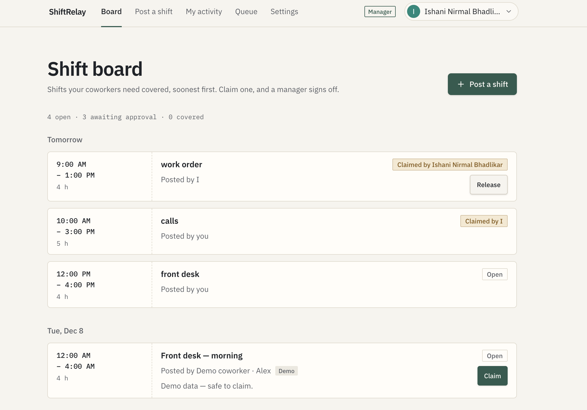

# ShiftRelay

A reliable shift handoff for one workplace: **post a shift → a coworker claims it → a manager approves or rejects.**
ShiftRelay records the handoff. It does not change any official schedule.

**Live:** https://shiftrelay.app.space · Built on the DeepSpace SDK.



## Try it in 5 minutes

1. **Sign in.** You join the team as a worker automatically on your first visit.
2. **Look at the board.** It has demo shifts tagged **Demo** (posted by "Demo coworker"s), including one pending claim.
3. **Become a manager.** Go to Settings → **Become a manager** and enter the reviewer invite code from the
   portal note. (This README contains no codes.) A **Queue** tab appears in the nav.
4. **Approve the demo claim** on the Queue. Its card on the board changes to **Covered**.
5. **Live flow with a second account.** Sign in with a different account in a private window.
   - Post a shift from one account and claim it from the other.
   - Approve the claim as the manager.
   - Both boards update without a reload.
   - A manager can never decide their own claim, so the manager must be the poster, not the claimant.

**If the demo shifts have passed:** post your own shift and run step 5. Demo shifts start 14+ days after each reset,
so this should only happen if the demo data hasn't been reset in a while.

## How it works

**Data model.** Five collections. Client writes are blocked on every one. Every write goes through a server action
that takes the actor from the session (never from the request) and does its own permission checks.

| Collection | Holds | Uniqueness |
|---|---|---|
| `team_members` | role (`worker` / `manager`) and display name, keyed by user id | one row per user |
| `shifts` | title, start, end, notes, poster | — |
| `claims` | who claimed which shift | **one claim per shift** |
| `decisions` | approved / rejected / released, by whom, when (claimant copied in for the audit trail) | **one decision per claim** |
| `invite_redemptions` | which manager invite was used, by whom | **one use per invite** |

**Shift state is derived, never stored.** No claim means the shift is *open*. A claim with no decision means *claimed*.
An approved claim means *covered*. A rejected or released claim means *open* again. Client and server use the same
derivation function, so they can't drift.

**Race safety, in plain words.** Two people acting at the same moment don't both win. The data store itself refuses
a second claim on a shift, or a second decision on a claim. The action that writes first wins; only that action
continues and sends email. The others get a clear message such as "Someone already claimed this shift." Nothing
depends on check-then-write timing.

**What the tests prove** (Playwright with real signed-in users, plus unit tests):
- **Double claim:** two users claim the same shift concurrently → exactly 1 succeeds. It passed 20/20 repeated runs with no
  double wins. In an early spike, 5 concurrent creates produced 1 success and 4 duplicates.
- **Decision race:** release and approve fired concurrently → exactly 1 decision, and both users see the same state.
- **Authorization:** a worker calling approve is rejected, and so is a manager approving their own claim.
- **Full suite:** 43 Playwright + 31 unit tests, green 3 times back-to-back.

**Manager invites** are stored as hashes in a DeepSpace secret and compared in constant time. They expire, and each
can be used once. A retry by the same person finishes the grant instead of failing.

## DeepSpace features used, and why

- **Sign-in.** Accounts come from the platform; the app keeps only its own team role per user.
- **Records + live `useQuery`.** Every board, queue and activity view updates in real time, with no polling code.
- **Server actions + `uniqueOn`.** All writes go through actions, and the uniqueness constraints are the race
  safety described above.
- **Secrets.** These hold the manager invite hashes. No secret is in the repo or the client bundle.
- **`email/send`.** Claims notify the poster and managers; approvals and rejections notify the claimant and poster;
  a release notifies the poster. Demo coworkers and the person acting aren't emailed. Only the winning
  action sends, and an email failure never undoes the state change. It's billed to the app owner. Tests run in dry-run mode,
  so they send no real email.

**Skipped, and why**
- **Messaging:** it's public-only, which is wrong for a team, and chat is out of scope anyway.
- **`setRole` for managers:** it grants app-wide platform admin. Manager is an app-level role in `team_members`
  instead, and platform admin stays with the owner.
- **AI, cron, payments:** none of them is needed for a reliable handoff (see below).

## Main tradeoffs

1. **Depth over breadth.** One handoff flow, made reliable under races, permissions and failures. Cancelling a
   shift, overlap checks, chat, multiple teams, cron reminders and AI were left out deliberately.
2. **Reads are open to any signed-in user**, even before joining. Platform permissions only see the platform role,
   not the app's team roles, so they can't restrict reads to team members. This is accepted because anyone signed
   in can join anyway. The alternative (all reads through actions) would lose the real-time views. Writes are
   unaffected: every write is checked in its action.

## Who did what

Built with **Claude Code** (the agent). I used **Claude** and **ChatGPT** to cross-check each other's designs
before any code. The full log is in [NOTES.md](NOTES.md).

**I directed and decided**
- The scope and the agreed architecture; I reviewed and approved every plan before code was written.
- Corrections, including:
  - decisions keep claimant fields, so the audit trail survives claim deletion;
  - the daily claim cap counts released and rejected claims too, so claim/release loops can't run up email spend;
  - demo shifts are dated far out, so they don't expire before review;
  - the strict production-bundle grep stays;
  - the shared-cap test flake gets fixed instead of documented.

**I verified by hand**
- Local and production click-throughs of every page and flow.
- Live sync between two accounts: a claim and a release appeared in the other window without a reload.
- Invite errors: wrong code, and an already-used code.
- A real notification email delivered to Gmail, with correct content and time.
- The owner-only demo reset.

**The agent did**
- The implementation: actions, schemas, UI.
- The tests, and the day-1 spikes that proved the platform behaviour the design relies on.
- Root-cause investigations: the test-flake cap counts, the dev-only 404, the email billing rows.
- The build and bundle checks, and the deploys.

## Known issues and next steps

- **Emails show times in UTC**, and arrive from "DeepSpace Apps <notifications@updates.app.space>". The platform
  ignores the app's sender. Some university mail filters drop them: the send succeeded and was charged, but the
  message never arrived.
- **Reviewers who become managers get claim emails** for every claim, since all managers are notified.
- **The soft caps aren't atomic** (3 open shifts per poster, 5 claims per user per day). Concurrent requests can
  slightly exceed them, which is fine for abuse limits.
- **The board loads every decision.** That's fine for one workplace, but it needs paging at thousands of rows.
- **Next:** email times in the recipient's time zone; email preferences and unsubscribe; a "Your shifts" filter;
  logging each successful send. More ideas are under "Later" in [NOTES.md](NOTES.md).

## Run locally

Requires Node 22.15+, 24 or 26 (see `engines` in package.json), npm 11.6+, and a DeepSpace account (`npm run login`).

```sh
npm install
npm run dev                                # local dev server; email is dry-run in dev builds
npm test                                   # all Playwright specs + unit tests (needs DeepSpace test accounts)
npm run build && npm run check:bundle      # production build + check that dev-only code is stripped
```

**Test accounts for `npm test`:** the specs look accounts up by name, so create eight on your own DeepSpace account named `Spike A`, `Outsider`, `Worker B`…`Worker F` and `Manager M` with `npx deepspace test accounts create --email <any>@deepspace.test --name "<name>" --password-stdin`, then generate local test invites with `node scripts/new-invite.mjs --test-fixtures | npx deepspace secrets set MANAGER_INVITES --stdin --config localtest`.

Secrets are set with `npx deepspace secrets`; none are in the repo.
